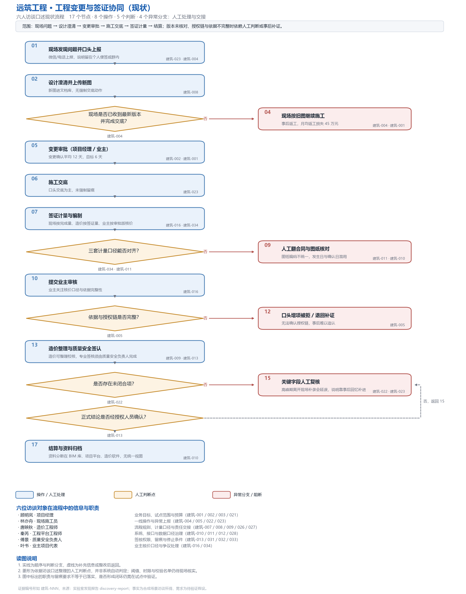
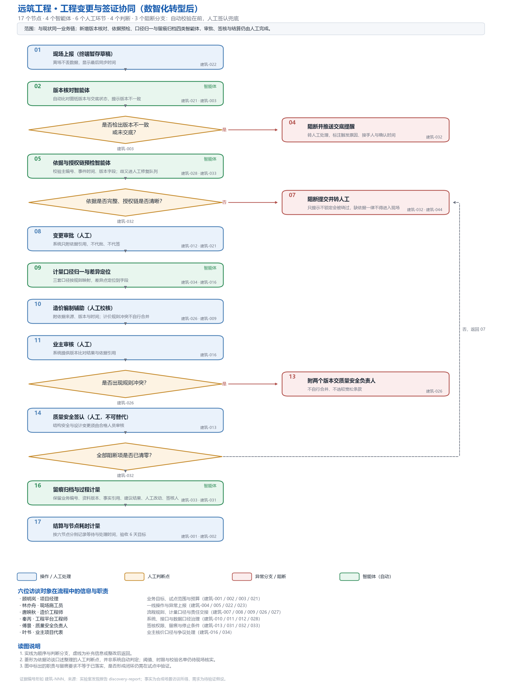

# 工程变更与签证协同 · FDE 交付物

> **选题**：远筑工程「工程变更与签证协同」AI 试点（挑战级 · `construction-change`）
> **来源**：FDE 训练中心项目库（54 个场景），与参考样例「赛事补给物资与站点协同」不同
> **交付物位置**：[`docs/fde-交付物/`](docs/fde-交付物/)

---

## 📦 四件套在哪里（全部可直接点开）

**位置：仓库根目录 → `docs` 文件夹 → `fde-交付物` 文件夹**
（直达链接：<https://github.com/wolf72898-spec/Expense_Assistant/tree/main/docs/fde-交付物>）

| # | 交付物 | 点开就是 | 核心内容 |
|---|--------|----------|----------|
| ① | **业务挖掘报告** | [docs/fde-交付物/01-业务需求发现报告.md](docs/fde-交付物/01-业务需求发现报告.md) | 实验室系统生成：6 岗位访谈、34/36 条事实、6 条需求假设（REQ-1~6） |
| ② | **行业分析**（docx） | [docs/fde-交付物/02-行业分析报告-….docx](docs/fde-交付物/02-行业分析报告-建筑业工程变更与签证协同.docx) | 行业规模、GB/T 50500-2024 政策变化、痛点量化、供给格局 |
| ③ | **现状流程图** | [docs/fde-交付物/03-现状流程图.png](docs/fde-交付物/03-现状流程图.png)（另有 [SVG](docs/fde-交付物/03-现状流程图.svg)） | 17 节点：12 操作 · 5 判断 · 4 异常分支 |
| ④ | **数智化转型后流程图** | [docs/fde-交付物/04-数智化转型后流程图.png](docs/fde-交付物/04-数智化转型后流程图.png)（另有 [SVG](docs/fde-交付物/04-数智化转型后流程图.svg)） | 17 节点：4 智能体 · 8 人工环节 · 3 处硬阻断 |
| ⑤ | **设计方案**（docx） | [docs/fde-交付物/05-设计方案-….docx](docs/fde-交付物/05-设计方案-工程变更与签证协同AI试点.docx) | 架构、模块、权限矩阵、验收与停止条件、实施计划 |
| ⑥ | **报价单**（xlsx） | [docs/fde-交付物/06-报价单-….xlsx](docs/fde-交付物/06-报价单-工程变更与签证协同AI试点.xlsx) | 243 人天 · 报价总计 **¥682,587** |

原始访谈材料（逐问逐答记录、事实清单、实验室原始导出）在 [`docs/fde-交付物/_raw/`](docs/fde-交付物/_raw/)，用于追溯复核。

---

## 🔍 两张流程图直接看

**转型前——变更/签证靠纸质流转，盖章往返、口径打架：**



**转型后——AI 起草与比对，人签认、系统硬阻断：**



---

## 📌 项目速览

| 项 | 内容 |
|---|---|
| 客户场景 | 远筑工程项目部：变更单/签证单多源记录、三套计量口径并存、盖章审批往返周期长 |
| 方案核心 | 4 个智能体（变更登记、制度比对、计量核算、台账归档）+ 8 个人工签认环节 + 3 处硬阻断 |
| 硬约束 | AI 不代签、不自动批准；结构安全与设计变更必须合格人员审核；缺依据/缺签/版本冲突一律阻断转人工 |
| 溯源要求 | 每条建议留存业务编号、资料版本、事实引用、人工改动、签核人（对应访谈事实 建筑-033） |
| 报价 | 243 人天，¥682,587（明细见报价单 xlsx） |

## 🔁 如何复现

```bash
pip install -r requirements.txt          # python-docx / matplotlib / openpyxl
python scripts/fde_interview.py --scenario construction-change   # 实验室访谈（需站点可访问）
python scripts/gen_industry_docx.py      # ② 行业分析
python scripts/gen_flowcharts.py         # ③④ 流程图
python scripts/gen_solution_docx.py      # ⑤ 设计方案
python scripts/gen_quote_xlsx.py         # ⑥ 报价单
```

## ⚠️ 三条前提（评审前必读）

1. **场景是合成案例**——事实来自角色口述，需求是待验证假设，不是已确认需求；
2. **覆盖率 34/36**——实验室接口两处 502，脚本容错跳过，缺失已如实标注；
3. **AI 不得作为质量安全判定依据**——所有阻断与签认由具备资格的人员完成，这是方案硬约束。

---

## 附录：本仓库另含一套企业报销智能体参考实现

与 FDE 交付物共用「规则版本化、字段级溯源、硬阻断闸门、权限隔离」同一套设计内核，FDE 方案四项机制直接复用其已验证实现。

- 能力：员工查制度/查本人单据，财务核事实、管制度（四模块，42 项验证全通过）
- 快速体验：`pip install -r requirements.txt && python scripts/init_policy.py && python scripts/demo.py`
- 详细说明与目录结构：见 [docs/00-开源调研与二次开发方案.md](docs/00-开源调研与二次开发方案.md)、[docs/01-技术架构设计.md](docs/01-技术架构设计.md)

## 开源合规

在 [bonc-ai/expense-assistant](https://github.com/bonc-ai/expense-assistant)（Apache-2.0 · Copyright 2026 BONC）基础上二次开发。
许可证义务见 [`THIRD_PARTY_LICENSES.md`](THIRD_PARTY_LICENSES.md)，版权声明见 [`NOTICE`](NOTICE)，内核修改登记见 [`engine/CHANGES.md`](engine/CHANGES.md)。

## License

本项目代码采用 Apache-2.0（`engine/` 继承上游）。上游版权归 BONC 所有，见 `NOTICE`。
